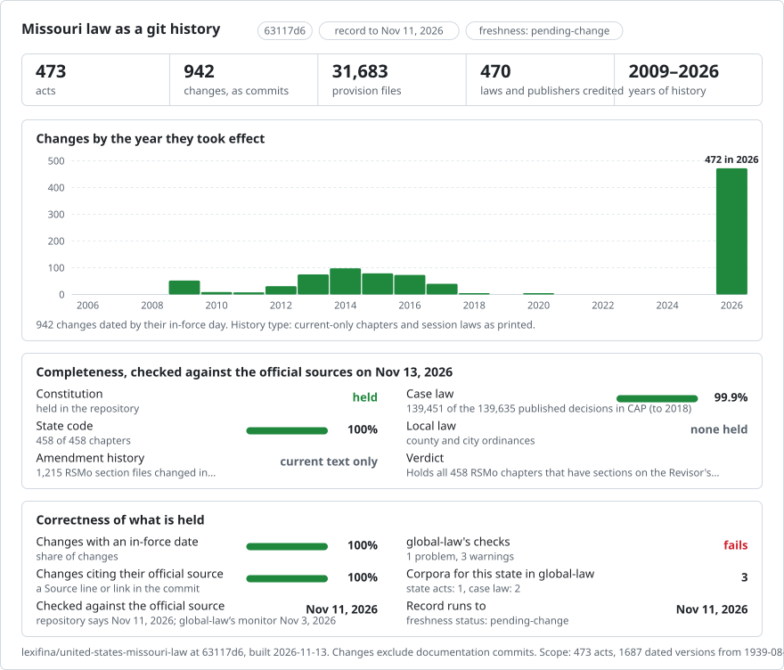

# United States (Missouri): current law in git

<picture>
<source media="(prefers-color-scheme: dark)" srcset="data/effort-dark.svg">

</picture>

Part of [lexifina/global-law](https://github.com/lexifina/global-law), one git history for every country's law: this is the law of Missouri, United States, which global-law reads at `united-states/missouri/acts/`.

| Folder | Act | Versions | History |
| --- | --- | ---: | --- |
| `rsmo-chapter-*/` | 458 normative Revised Statutes chapters | 1 | Current-only oldest available text |
| `constitution-*/` | Missouri Constitution: 14 articles and preamble | 1 | Current-only oldest available text |
| `session-law-*/` | 540 selected regular-session laws, 2009–2025 | 1 each | As printed in the official session-law volumes |

Source: [Missouri Revisor of Statutes](https://revisor.mo.gov/main/Home.aspx), an uncertified posting by the official Revisor. Future-effective section versions and court annotations are excluded. Textual tables and the statutory law-line footnotes are retained.

Statute chapter dates are the latest printed effective date among current sections. Amendment dates for constitutional articles use the current-section dates displayed by the Revisor. Original 1945 commencement remains unresolved for unchanged folders. Corrections preserve the original commits and override their stated date ranges. No earlier wording is reconstructed.

Revisor restoration notes determine the current wording where a later enactment was invalidated. Five conflicting sections and five sections with a contingent effective date retain both printed forms in separate provision files; these alternatives do not assert that both apply simultaneously. Prior published versions remain in the history.

## Earlier session laws

540 regular-session laws from the official 2009–2025 Session Laws of Missouri are retained as printed, each in its own `session-law-*/` folder. The session-law text and amendment brackets are retained as plain text; publisher explanations are included where they fall within the bill span. PDF boldface is not reproduced. Matter in brackets is expressly not enacted; these records are legislative prints, not clean consolidated statutes. Records use the regular-session effective date stated in their volume or an explicit whole-act commencement clause with its printed approval date. Bills with unresolved or mixed commencement dates or unresolved text extraction are excluded. Appropriations, extraordinary-session laws, vetoes, resolutions and ballot measures are outside this addition. Earlier versions of the consolidated chapters are not reconstructed.

| Session-law year | Bills in the first 308-law addition |
| --- | ---: |
| 2009 | 40 |
| 2010 | 8 |
| 2011 | 6 |
| 2012 | 26 |
| 2013 | 47 |
| 2014 | 61 |
| 2015 | 53 |
| 2016 | 44 |
| 2017 | 21 |
| 2020 | 2 |

Source: [Missouri Revisor, publications](https://revisor.mo.gov/main/Info.aspx), annual official session-law volumes.

## Further session-law additions

113 additional as-printed session laws have the regular-session effective date given by their official volume preface. The selected prints do not identify a different date for the act as a whole. Unresolved exceptional commencements and source images remain outside these additions.

## Additional as-printed session laws

20 additional official session-law prints have the regular-session effective date given in their annual volume preface. No act-level special commencement was identified for these prints.

## Further 2009 session laws

2 official as-printed session laws are dated by the regular-session effective date in their volume preface. Unresolved commencement, extraction and graphic questions remain excluded.

## Further 2010 session laws

1 official as-printed session laws are dated by the regular-session effective date in their volume preface. Unresolved commencement, extraction and graphic questions remain excluded.

## Further 2011 session laws

1 official as-printed session laws are dated by the regular-session effective date in their volume preface. Unresolved commencement, extraction and graphic questions remain excluded.

## Further 2012 session laws

1 official as-printed session laws are dated by the regular-session effective date in their volume preface. Unresolved commencement, extraction and graphic questions remain excluded.

## Further 2013 session laws

2 official as-printed session laws are dated by the regular-session effective date in their volume preface. Unresolved commencement, extraction and graphic questions remain excluded.

## Further 2014 session laws

1 official as-printed session laws are dated by the regular-session effective date in their volume preface. Unresolved commencement, extraction and graphic questions remain excluded.

## Further 2015 session laws

3 official as-printed session laws are dated by the regular-session effective date in their volume preface. Unresolved commencement, extraction and graphic questions remain excluded.

## Further 2016 session laws

2 official as-printed session laws are dated by the regular-session effective date in their volume preface. Unresolved commencement, extraction and graphic questions remain excluded.

## Further 2009 session laws

4 official as-printed session laws use their explicit whole-act commencement clauses and printed approval dates. Laws with mixed or unresolved commencement dates remain excluded.

## Further 2011 session laws

1 official as-printed session laws use their explicit whole-act commencement clauses and printed approval dates. Laws with mixed or unresolved commencement dates remain excluded.

## Further 2012 session laws

1 official as-printed session laws use their explicit whole-act commencement clauses and printed approval dates. Laws with mixed or unresolved commencement dates remain excluded.

## Further 2013 session laws

1 official as-printed session laws use their explicit whole-act commencement clauses and printed approval dates. Laws with mixed or unresolved commencement dates remain excluded.

## Further 2014 session laws

3 official as-printed session laws use their explicit whole-act commencement clauses and printed approval dates. Laws with mixed or unresolved commencement dates remain excluded.

## Further 2016 session laws

3 official as-printed session laws use their explicit whole-act commencement clauses and printed approval dates. Laws with mixed or unresolved commencement dates remain excluded.

## Further 2017 session laws

2 official as-printed session laws use their explicit whole-act commencement clauses and printed approval dates. Laws with mixed or unresolved commencement dates remain excluded.

## Further 2009 session laws

26 official as-printed session laws use the regular-session effective date expressly stated in their volume. Bills with exceptional commencement wording or unresolved text extraction remain excluded.

## Further 2010 session laws

7 official as-printed session laws use the regular-session effective date expressly stated in their volume. Bills with exceptional commencement wording or unresolved text extraction remain excluded.

## Further 2011 session laws

12 official as-printed session laws use the regular-session effective date expressly stated in their volume. Bills with exceptional commencement wording or unresolved text extraction remain excluded.

## Further 2012 session laws

19 official as-printed session laws use the regular-session effective date expressly stated in their volume. Bills with exceptional commencement wording or unresolved text extraction remain excluded.

## Further 2015 session laws

1 official as-printed session laws use the regular-session effective date expressly stated in their volume. Bills with exceptional commencement wording or unresolved text extraction remain excluded.

## Further 2009 session laws

6 official as-printed session laws use the regular-session effective date expressly stated in their volume or an explicit whole-act commencement clause. Bills with mixed or unresolved commencement dates or unresolved text extraction remain excluded.
